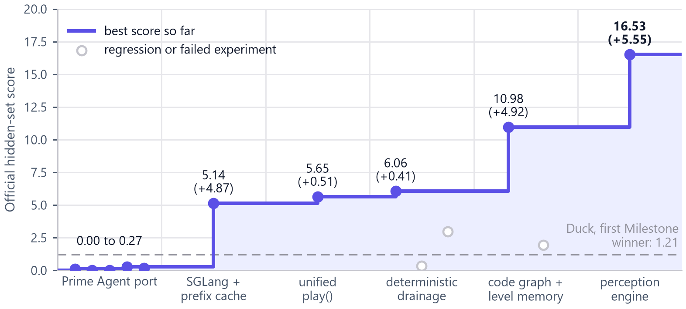
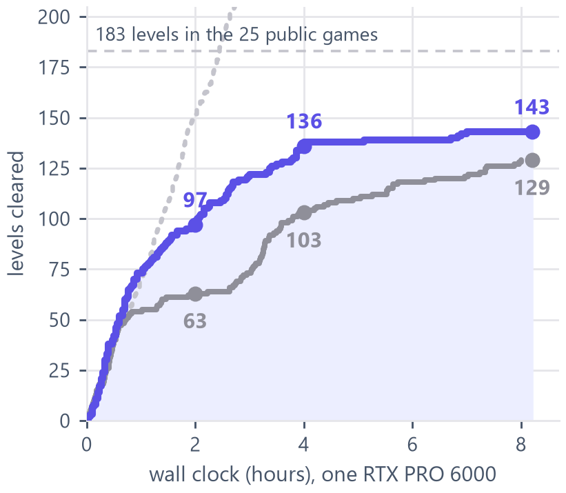
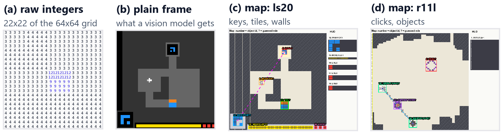

# SARBLOH

**An offline, open-weight agent for [ARC-AGI-3](https://arcprize.org/arc-agi/3/) (ARC Prize 2026), built around a
perception engine.**

> **Paper:** *Transforming Integer Grids to Spatial Intuition: Perception, Not Planning, Governs ARC-AGI-3*
> (arXiv preprint, AAAI-27 format). Source in [`Writing/`](Writing/); build it with the steps in
> [Build the paper](#4-build-the-paper).
>
> **Kaggle hidden-set score:** **16.53**, the score the paper reports (26 Oct 2026). That is 13.7x the 1.21 that won
> Milestone #1. The final leaderboard score at the close was about 17.01, from a later submission that the paper does
> not analyse.[^final]

ARC-AGI-3 drops an agent into a game it has never seen, with no instructions. It is scored by how few actions it
needs compared with a human. On Kaggle it must also run offline, on one GPU, within nine hours. Our thesis is
that the first thing to break is *seeing*, not planning. So every frame goes through a deterministic perception
engine before the model reads it, and the model then acts by writing and running Python.

*Sarbloh* means "all-steel".

---

## Contents

- [Results](#results)
- [How it works](#how-it-works)
- [The two agent folders](#the-two-agent-folders)
- [Repository map](#repository-map)
- [Pipelines and how to run them](#pipelines-and-how-to-run-them)
- [What did not work](#what-did-not-work)
- [Experiments index](#experiments-index)
- [How we worked](#how-we-worked)
- [Licence, citation, acknowledgements](#licence)

---

## Results

| | |
| --- | --- |
| **Kaggle hidden-set score** | **16.53** (26 Oct 2026) in the paper. The final leaderboard score was about 17.01.[^final] |
| Public games, one pass, 8.2 h | **143 / 183 levels** cleared across the 25 games |
| Same server and model, Duck harness (4 passes per game) | 129 distinct levels in the same time |
| Median cleared level | 0.77x the human baseline's actions (earns the 1.15 RHAE cap) |
| Prompt tokens served from the prefix cache | **98.4%** over the 8.2 h run (about 10% before the append-only rewrite) |
| Model calls / server failures | 21,224 / 0 |
| Hardware | one NVIDIA RTX PRO 6000 (96 GB), offline |
| Model | Qwen3.8-Flash-Next: 125B MoE, 6B active, W4A16 (AutoRound), served by SGLang with speculative decoding |

**How the hidden-set score moved.** Each step is one change, each submitted and scored on Kaggle:

| Score | Change |
| --- | --- |
| 0.00-0.27 | Prime Agent ported to open weights. It reset levels again and again and never found a goal. |
| 5.14 | Switched to Qwen3.8-Flash-Next on SGLang with speculative decoding |
| 5.65 | One tool: moves are sent from inside the Python kernel (`await play()`) |
| 6.06 | Deterministic context drain instead of summarisation |
| 10.98 | Persistent memory as kernel variables (`GOAL`, `PLAN`, `HYPOTHESES`, `FINDINGS`) |
| **16.53** | The full perception engine, plus a refined drain |

The public-game numbers are a development signal only, because those games are partly memorised by now. The hidden
Kaggle score is the only uncontaminated number. The leaderboard leaders are far ahead (71.48 on 26 Oct), and the paper
says so plainly.





---

## How it works



```
            ┌──────────────────────── Perception engine (host side, pure code, ~35 ms/frame) ────────────────────────┐
 ArcHost ──►│ 1 segment + track ─► 2 layout ─► 3 measure facts ─► 4 guess roles + tests ─► 5 render map + letters │
 (game)     └──────────────────────────────────────────────────────────────────────────────────────┬────────────────┘
    ▲                                                                                               │ views
    │ moves, one at a time                                                                          ▼
 IPython kernel (the only tool) ◄── code ── Qwen3.8-Flash-Next (SGLang) ◄── prompt ── Context builder (append-only)
 observe() · play(path, predict) · recall() · graph() · GOAL/PLAN/HYPOTHESES/FINDINGS

 25 sessions ──► priority scheduler (10 GPU slots) ──► one model server with a watchdog; curator at every level-up
```

### 1. Perception engine: [`agent/perception.py`](Sarbloh/harness/agent/perception.py)
Every frame becomes three views that share one set of object ids:
- **Objects, letters and change lines.** Objects are 4-connected regions of one colour. They are tracked across
  steps in five passes (unchanged, moved, recoloured, reshaped, new), so `obj 10` means the same thing for a whole
  level. The board is drawn as one letter per colour, and each move adds one change line:
  `#12 A4(right): 6 cells changed at r10-12 c20-25`.
- **The briefing.** `MEASURED` facts are computed, so they are true by construction: reach (BFS on the tile
  lattice), enclosure, tethers and midpoints, alignment, look-alikes under the 8 square symmetries times scale,
  copies, and lopsided colours. `GUESSES` are roles (YOU, GOAL, MOVES LEFT, LIVES, INVENTORY, MODIFIER, HANDLE,
  CARRIED). Each one is printed with a confidence and **the one action that would confirm it**.
- **The picture.** A map of the layout rather than raw pixels: floor, walls, panels, tile lattice, role-tagged
  boxes, look-alike threads, midpoint rings, and an enlarged HUD panel.

The design was chosen in a perception lab ([`experiments/E115_perception_lab`](experiments/E115_perception_lab)),
where eight competing designs were graded on a 28-point rubric. The winner scored 25/28, against 3/28 for the old
encoder, at a tenth of the tokens. A held-out check on 23 games found that single-frame role guesses are right only
about half the time. That is why they are labelled as guesses and come with a test.

### 2. Acting in code: [`runtime/skills/acting.py`](Sarbloh/harness/runtime/skills/acting.py)
There is one tool: a persistent IPython kernel, ported from
[Prime Agent](https://github.com/PrimeIntellect-ai/prime-agent). The agent models the game in Python, searches its
model, and sends the whole path with `await play(path, predict)`. `play()` reports the first move its model got wrong.
It stops early on a level-up, a game over, a revisited board, or a wall hit twice.

The host owns the game ([`game/arc_host.py`](Sarbloh/harness/game/arc_host.py)). It checks and logs every move and
restarts lost levels. The kernel cannot read the game files
([`runtime/skills/fileguard.py`](Sarbloh/harness/runtime/skills/fileguard.py)).

### 3. Memory and context: [`agent/context.py`](Sarbloh/harness/agent/context.py), [`memory/`](Sarbloh/harness/memory)
- **Append-only prompt.** The model is a Gated DeltaNet hybrid, so any edit to an old message forces a full
  prefill. Nothing already sent is changed: each picture is stored once, and memory goes in as diffs. Result: 98.4%
  prefix reuse.
- **Drain, not summarise.** Past 118k tokens, the oldest whole turns are dropped until 55k remain. No model call is
  involved.
- **Memory as variables.** `GOAL`, `PLAN`, `HYPOTHESES` and `FINDINGS` are kernel dicts keyed by level. A hidden
  **curator** runs at every level-up. It updates a cross-game lessons graph, which includes a store of refuted rules,
  and picks the skill notes that `recall()` loads.
- **Code graph** ([`runtime/skills/codegraph.py`](Sarbloh/harness/runtime/skills/codegraph.py)). After every cell,
  one line says what the agent's code defined or changed, and which calls point at something missing.

### 4. Serving and scheduling: [`llm/`](Sarbloh/harness/llm), [`scheduler.py`](Sarbloh/harness/scheduler.py)
- SGLang behind a profile chain, a tool-call smoke test and a watchdog. A frozen server counts as failed even when
  its process is alive. Restarts are budgeted by the wall clock left.
- A priority scheduler keeps 25 games alive on 10 GPU slots. A free slot goes to the waiting game with the best
  value of (RHAE weight of its next level) x (hope). Hope decays with the tokens and actions spent without progress.
- Everything model-specific lives in one spec file per model (`qwen_flash_next.py`, `qwen.py`, `gemma.py`,
  `nemotron.py`). The rest of the harness is model-free.

### 5. Alignment pipelines: [`Alignment/`](Alignment)
LoRA SFT and LoRA GRPO on the agent's own cleared-level traces, using torch + transformers + peft and no TRL. They
come with a Kaggle notebook plus TPU and Colab variants. Both are built and tested, but SFT made play worse (see
[What did not work](#what-did-not-work)). The submitted agent therefore runs the base model.

---

## The two agent folders

| Folder | What it is | Use it for |
| --- | --- | --- |
| [`Sarbloh/`](Sarbloh/) | **The agent the paper describes.** A clean snapshot, promoted from the lab copy on 25 Oct 2026 and finished for submission on 27 Oct. | Reading the code, reproducing the paper |
| [`Sarbloh-Experimentation/`](Sarbloh-Experimentation/) | **The lab copy.** It was forked from `Sarbloh/` on 1 Oct 2026, and every daily experiment ran here first (see [`experiments/`](experiments/)). It is rough by design: half-finished ideas, extra model specs (`deepseek_v4.py`, `glm.py`), a stuck-review lane (`review_lane.py`) and geometry tools (`runtime/skills/geometry.py`) that came after the paper's snapshot. | Seeing how the agent evolved, and what was tried after the snapshot |

Both folders share the same layout and run the same way. The last submission notebook,
[`kaggle/experimental/sarbloh_experimentation.ipynb`](kaggle/experimental/sarbloh_experimentation.ipynb), picks the
folder with its `AGENT_DIR` setting, which is set to the lab copy. Set it to `Sarbloh` to run the paper's snapshot.

---

## Repository map

```
SARBLOH/
  Sarbloh/                  the agent the paper describes
    harness/                ours: run.py (entry point), config.py (every knob), scheduler.py, trace.py, speed.py
      agent/                agent.py (turn loop), perception.py, context.py, guardrails.py, curator.py, prompts.py
      runtime/              kernel host + skills the model can call (acting, observation, codegraph, recalling)
      memory/               working memory, timeline, lessons graph, skill book
      game/                 arc_host.py (the only game access), games.py (Arcade wrapper)
      llm/                  client, server + watchdog, SGLang launcher, one spec per model
    rlm/                    Prime Agent's Python kernel runtime, vendored unchanged (MIT, see rlm/LICENSE)
  Sarbloh-Experimentation/  the lab copy where every experiment ran first (see above)
  Alignment/                LoRA SFT + GRPO pipelines, Kaggle notebook, Colab/TPU/Azure variants
  Writing/                  the paper: main.tex, sections/, figures/, data/, scripts/ (rebuild every number and figure)
  kaggle/                   notebooks: main.ipynb (stage-1 Duck baseline), experimental/ (every launcher we ran,
                            incl. sarbloh_experimentation.ipynb, the last submission), wheels.ipynb (offline wheels)
  eval/                     official RHAE scorer, bench driver, the 25 public games for offline play, frozen splits
  experiments/              one folder per experiment (index below); BACKLOG.md is the full catalogue
  history/                  the run ledger: LEDGER.md (readable), ledger.jsonl, baselines.json
  planning/                 MISTAKES.md (every costly mistake and its cause), ROADMAP.md, decisions/ (ADRs), designs/
  resources/                INDEX.md: every paper (arXiv id) and repo (licence, commit) we read; official/ rule snapshots
  scripts/                  kaggle_push.py (push/poll/download every notebook), local LLM server + smoke test
  tests/                    unit / component / regression suites (scripts, not pytest)
  CLAUDE.md                 the operating spec the work ran under (rules, verified Kaggle facts, decisions)
```

Not in git, because of size or licence: run logs (`runs/`), model weights, third-party clones and PDFs (listed in
`resources/INDEX.md` instead), and ARC's published game recordings.

---

## Pipelines and how to run them

Requires Python 3.12 and [uv](https://docs.astral.sh/uv/).

```bash
uv sync                                   # base environment: arc-agi, notebook, LLM client, dev tools
uv sync --group train                     # + torch, transformers, peft for the alignment pipelines
uv run python tests/run_all.py            # 34 suites, ~900 checks, CPU only, under a minute
```

### 1. Submission pipeline (Kaggle, offline)
```
git push ──► Kaggle dataset banwait13/sarblohagent (mirror of this repo)
                 │
kaggle/experimental/sarbloh_experimentation.ipynb
  1. print the environment (GPU, Python, arc-agi version, actions)    4. play all games in parallel
  2. install offline wheels, start SGLang + watchdog                   5. score, write summary + ledger row
  3. merge CONFIG over harness/config.py, print its hash              6. tear down the server, always
```
```bash
uv run python scripts/kaggle_push.py experimentation          # push + run the notebook
uv run python scripts/kaggle_push.py experimentation-status   # poll
uv run python scripts/kaggle_push.py experimentation-output   # download outputs into runs/
```
Kaggle credentials go in a git-ignored `.env` (`KAGGLE_USERNAME` + `KAGGLE_KEY`) or in `~/.kaggle/kaggle.json`. The
run writes a summary, per-game transcripts and pictures, and SFT rows.

### 2. Local development
Play against any OpenAI-compatible server (llama.cpp, vLLM, SGLang). Local runs test the plumbing only: a small local
model's score says nothing about the 6B-active model on Kaggle. **First set `local_SFT_RUN = False` in
`Sarbloh/harness/config.py`.** While it is True, the local entry point collects traces through the DeepSeek API
instead.

```bash
.\scripts\serve_llm.ps1                   # llama.cpp server on http://127.0.0.1:8080/v1 (Windows)
uv run python scripts/llm_smoke.py        # endpoint up? answer correct? tok/s?
cd Sarbloh
uv run python -m harness.run --games ls20 --minutes 10 --max-actions 60 \
    --base-url http://127.0.0.1:8080/v1 --ctx 16384 --vision
```

See the perception engine on a real frame. This writes the map, the plain frame, the briefing and the object list:

```bash
uv run python Writing/scripts/make_perception_figure.py ls20 r11l
cat Writing/figures/perception/ls20/briefing.txt
```

### 3. Alignment (LoRA SFT, then GRPO)
```
run traces (sft_levels.jsonl) ──► lora_sft.py: assistant-only loss masks ──► LoRA ──► result card (PASS/FAIL checks)
                                          └──► lora_rl.py: GRPO on the same prompts, KL to the base, SFT adapter as init
```
```bash
uv run python scripts/kaggle_push.py alignment          # sync the notebook's source cells, push, run on a T4
uv run python scripts/kaggle_push.py alignment-status   # then alignment-output
```

### 4. Build the paper
```bash
uv run python Writing/scripts/collect_data.py           # every number, each with its source
uv run python Writing/scripts/extract_curves.py         # levels over time from the run logs
uv run python Writing/scripts/make_perception_figure.py ls20 r11l
uv run python Writing/scripts/plot_results.py           # PDFs for the paper, PNGs for this README
cd Writing && latexmk -pdf main.tex                     # -> Writing/output/main.pdf (needs TeX Live)
```
`collect_data.py` and `extract_curves.py` read run folders under `runs/`, which are too large for git. Their output
is committed in [`Writing/data/`](Writing/data/), so the figures and the PDF build without them.

---

## What did not work

Negative results carry the same weight as positive ones. The full account is in the paper's appendix ("Negative
Results, Ablations, and Runtime Boundary Conditions") and in [`planning/MISTAKES.md`](planning/MISTAKES.md).

- **LoRA SFT on our own cleared levels.** Training loss fell from 11% to 6%, but the agent played worse on unseen
  games: it memorised coordinate paths. SFT took over 80% of the training compute and gave nothing back.
- **Replacing old code with comment stubs** to save context. The 6B-active model copied the stub template instead
  of writing code, in 97.7% of turns, and cleared 0 of 97 levels.
- **Sending only frame deltas.** It saves tokens, but it hides effects that happen far from the cell that changed,
  so the model concluded that working actions did nothing and looped.
- **Separate tools for code and for moves.** The model kept leaving the kernel to step and then rebuilding its state.
  Merging them into `await play()` took the hidden score from 5.14 to 5.65.
- **Prime Agent's subagents (`rlm.spawn`).** Zero productive calls across every run.
- **Holding loops at the action cap.** In one run, four games answered "Holding..." about 14,000 times and used 1.24 B
  of the 1.78 B prompt tokens. It cost wall clock, not score.

---

## Experiments index

Every experiment folder has a `hypothesis.md` written before any code: the mechanism, the prediction and the kill
criterion. Where a `verdict.md` exists, its outcome is shown below. "Open" means the change was folded into the
agent, or dropped, without a written verdict. [`experiments/BACKLOG.md`](experiments/BACKLOG.md) lists ideas that
never got a folder.

| ID | Question | Outcome |
| --- | --- | --- |
| [E001](experiments/E001_duck_fast_vllm) | Duck baseline + our fast vLLM layer | Open |
| [E003](experiments/E003_prime_harness_smoke) | Prime Agent harness smoke test (Gemma-4-31B) | Plumbing pass, agent fail |
| [E004](experiments/E004_forced_harness_local) | Forced Continual Harness + per-cell action cap | Inconclusive, superseded by E005 |
| [E005](experiments/E005_prime_fidelity) | Faithful Prime host + precise ARC interface | Open (audit + autopsy inside) |
| [E006](experiments/E006_dedicated_tools) | Dedicated tools, planner, REPL world model | Open |
| [E007](experiments/E007_vllm_dual_model) | One vLLM layer for two models; watchdog | Watchdog kept |
| [E008](experiments/E008_perception_memory) | Per-transition perception + agent-owned memory | Open |
| [E02](experiments/E02_png_scaled_perception) | Frame deltas vs whole-frame image | Kept: 10x PNG |
| [E03](experiments/E03_segmentation_ascii) | Segmentation + ASCII grid beside the image | Kept |
| [E08](experiments/E08_transition_database) | Queryable transition database | Kept (JSON log) |
| [E018](experiments/E018_wrong_rulebook) | Per-game store of refuted rules | Open |
| [E021](experiments/E021_versioned_goal) | Explicit, versioned goal hypothesis | Useful, kept |
| [E022](experiments/E022_level_review) | Review of the whole level at every level-up | Plumbing pass, effect not measured |
| [E039](experiments/E039_lessons_reconcile) | Reconcile lessons against refuted rules | Open |
| [E84](experiments/E84_quantisation) | Quantisation ablation | Kept: NVFP4 |
| [E105](experiments/E105_oracle_briefing) | Oracle briefing: understanding vs execution | Kept, prediction held |
| [E106](experiments/E106_timeline_toon) | Timeline in TOON instead of JSON | Open |
| [E107](experiments/E107_lora_sft_pipeline) | LoRA SFT pipeline | Kept (pipeline); see negative results |
| [E108](experiments/E108_lora_rl_pipeline) | LoRA GRPO pipeline | Kept (pipeline) |
| [E109](experiments/E109_sglang_serving) | SGLang instead of vLLM | Inconclusive, superseded by E112 |
| [E110](experiments/E110_fast_thinking_prompts) | Prompts that keep thinking short | Open |
| [E111](experiments/E111_priority_scheduler) | Priority scheduler for GPU slots | Open (in the agent) |
| [E112](experiments/E112_nvfp4_sglang_serving) | NVFP4 + MTP on SGLang | Kept: >500 tok/s at 10 streams |
| [E113](experiments/E113_engine_world_model) | Agent writes the game in `arcengine` | Open |
| [E114](experiments/E114_harness_self_evolution) | Harness self-evolution, frozen backbone | Open |
| [E115](experiments/E115_perception_lab) | Perception lab: eight designs, one rubric | Kept: X8, 25/28 |
| [E116](experiments/E116_x8_perception) | X8 perception in the agent (`observe()`) | Open (in the agent) |
| [E117](experiments/E117_act_to_verify) | Verify by acting, not by writing checks | Open |
| [E118](experiments/E118_level_skills) | Skills written at every level-up | Open |
| [E119](experiments/E119_engine_rebuild) | Rebuild the game from observations, plan in the copy | Open |
| [E120](experiments/E120_glm) | GLM-4.6V as the agent model | Open |
| [E121](experiments/E121_sft_wire_trace) | SFT traces from the exact wire | Open |
| [E122](experiments/E122_guardrails) | Duck guardrails we lacked | Open (in the agent) |
| [E123](experiments/E123_play_until_surprise) | `play()`: send a plan, stop at the first surprise | Open (in the agent) |

Every scored run also has a row in [`history/LEDGER.md`](history/LEDGER.md).

---

## How we worked

- **Iteration beats theory.** Push to Kaggle, read the trace, refine, repeat. A run that scores 0 but leaves a trace is
  worth more than a design document.
- **Every change is an experiment.** `hypothesis.md` comes before the code, and `verdict.md` records whether the
  change was kept, killed or inconclusive. Negative results stay.
- **Everything is wrong until a run proves it**, including our own explanations of the model's behaviour.
- **Method follows hardware.** RL is a hypothesis like any other: it has to beat LoRA SFT inside Kaggle's budget.
- **Mistakes are logged by cause.** Anything that cost over an hour is in
  [`planning/MISTAKES.md`](planning/MISTAKES.md).

The full operating spec is [`CLAUDE.md`](CLAUDE.md). It was written for the coding agent that worked alongside us,
and parts of it describe plans that were later replaced.

---

## Licence

MIT-0: see [`LICENSE`](LICENSE) and [`NOTICE`](NOTICE). `Sarbloh/rlm/` is vendored from Prime Agent and keeps its
MIT licence. The 25 public games in `eval/real_games/` belong to the ARC Prize Foundation. Model weights and
third-party repositories are not redistributed.

## Citation

```bibtex
@misc{banwait2026sarbloh,
  title  = {Transforming Integer Grids to Spatial Intuition: Perception, Not Planning, Governs {ARC-AGI-3}},
  author = {Banwait, Harsidak Singh},
  year   = {2026},
  note   = {arXiv preprint},
  url    = {https://github.com/Harsidak/SARBLOH}
}
```

## Acknowledgements

The ARC Prize Foundation for ARC-AGI-3. Prime Intellect for Prime Agent, whose kernel and host loop this harness
started from. Tufa Labs for the Duck harness, the Milestone #1 winner and our baseline throughout.

[^final]: The paper reports 16.53, the best verified score when it was written (26 Oct 2026). The final leaderboard
    score at the close of the competition was about 17.01.
