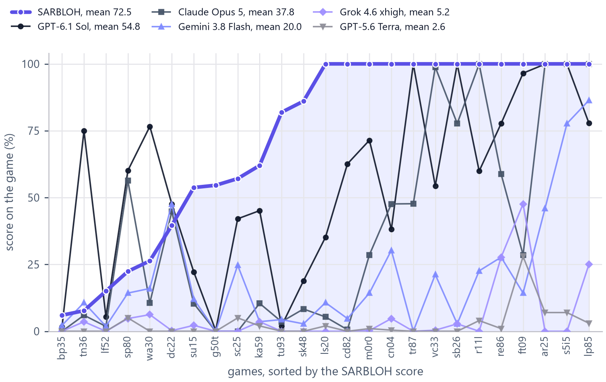
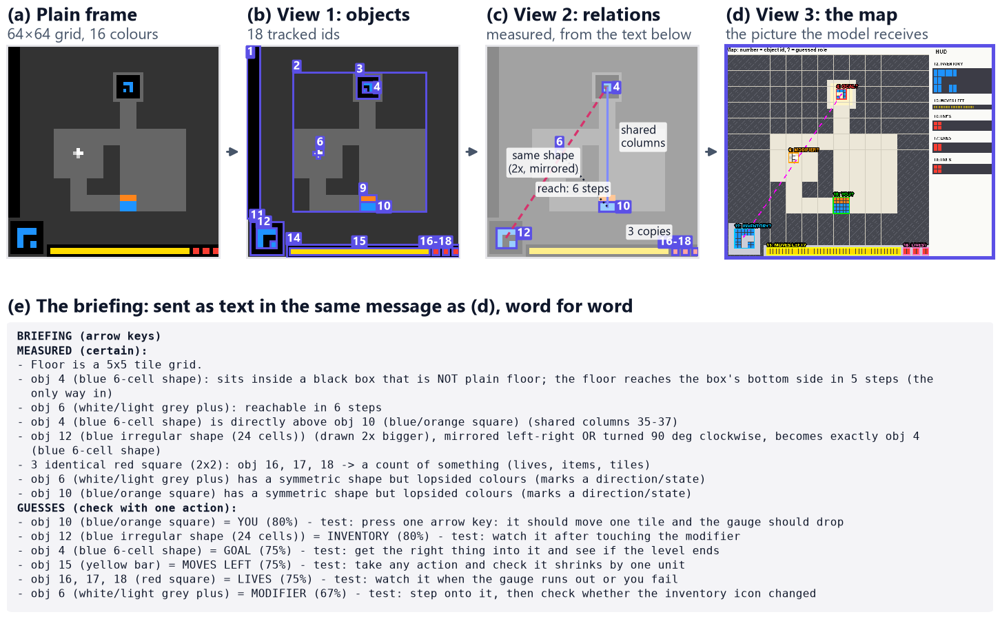

<div align="center">

# SARBLOH

### Transforming Integer Grids to Spatial Intuition:<br>Perception, Not Planning, Governs ARC-AGI-3

[](https://arxiv.org/abs/2611.06793)
[](https://www.kaggle.com/competitions/arc-prize-2026-paper-track/writeups/transforming-integer-grids-to-spatial-intuition)
[](https://www.kaggle.com/code/banwait13/sarbloh-experimentation/notebook)
[](https://www.kaggle.com/dsv/21700961)
[](https://harsidaksinghbanwait.com/blog/7)
[](LICENSE)

[✨ Getting started](#-getting-started) • [📖 How it works](#-how-it-works) • [🗂️ Repository](#️-repository)

[📌 Citation](#-citation) • [🌻 Acknowledgements](#-acknowledgements) • [📫 Contact](#-contact)

</div>

---

**SARBLOH** is an offline, open-weight agent for [ARC-AGI-3](https://arcprize.org/arc-agi/3/) (ARC Prize 2026).
ARC-AGI-3 drops an agent into a game it has never seen, with no instructions, and scores it by how few actions it
needs compared with a human. Our bet: what breaks first is *seeing*, not planning. So every frame passes through a
deterministic perception engine before the model reads it, and the model then acts by writing and running Python.

<div align="center">

**16.53** on the hidden Kaggle set &nbsp;·&nbsp; **143 / 183** public levels in one pass &nbsp;·&nbsp;
**35 ms** perception per frame &nbsp;·&nbsp; **one GPU, offline, 9 h**



<sub>Action efficiency on the 25 public ARC-AGI-3 games, sorted by SARBLOH's score. SARBLOH runs an open-weight
model on one GPU; the other five are frontier API models. Each SARBLOH point is its best score on that game across
runs.</sub>

</div>

> [!NOTE]
> Public-game scores are a development signal only, since those games are partly memorised by now. The hidden Kaggle
> score is the uncontaminated number. The paper reports 16.53 (26 Oct 2026); the final leaderboard score at the close
> was about 17.01, from a later submission the paper does not analyse.

*Sarbloh* means "all-steel".

---

## 📖 How it works

<div align="center">

</div>

1. **See.** A zero-parameter perception engine ([`perception.py`](Sarbloh/harness/agent/perception.py)) turns each
   64×64 frame into tracked objects, a map, and a **briefing** that separates `MEASURED` facts (true by construction)
   from `GUESSES` (each with a confidence and the one action that would test it).
2. **Think in code.** One tool: a persistent Python kernel. The agent models the game, searches its model, and sends a
   whole path with `await play(path, predict)`, which stops at the first move its model got wrong.
3. **Remember.** `GOAL`, `PLAN`, `HYPOTHESES` and `FINDINGS` live as kernel variables. The prompt is append-only, so
   98.4% of prompt tokens come from the prefix cache, and a curator writes cross-game lessons at every level-up.
4. **Serve.** Qwen3.8-Flash-Next (125B MoE, 6B active, W4A16) on SGLang, with a watchdog and a scheduler that keeps 25
   games alive on 10 GPU slots.

The full account, with ablations and negative results, is in the [paper](https://arxiv.org/abs/2611.06793).

---

## ✨ Getting started

Requires Python 3.12 and [uv](https://docs.astral.sh/uv/).

```bash
git clone https://github.com/Harsidak/SARBLOH && cd SARBLOH
uv sync                                   # base environment
uv run python tests/run_all.py            # CPU-only test suites, under a minute
```

**See the perception engine on a real frame.** This writes the map, the plain frame, the briefing and the object list:

```bash
uv run python Writing/scripts/make_perception_figure.py ls20 r11l
cat Writing/figures/perception/ls20/briefing.txt
```

**Play locally** against any OpenAI-compatible server (llama.cpp, vLLM, SGLang). This tests the plumbing only: a small
local model's score says nothing about the Kaggle run.

> [!IMPORTANT]
> Set `local_SFT_RUN = False` in [`Sarbloh/harness/config.py`](Sarbloh/harness/config.py) first. While it is `True`,
> the local entry point collects traces through the DeepSeek API instead.

```bash
cd Sarbloh
uv run python -m harness.run --games ls20 --minutes 10 --max-actions 60 \
    --base-url http://127.0.0.1:8080/v1 --ctx 16384 --vision
```

**Run on Kaggle.** Open the [notebook](https://www.kaggle.com/code/banwait13/sarbloh-experimentation/notebook), or push
your own copy (credentials in a git-ignored `.env` or `~/.kaggle/kaggle.json`):

```bash
uv run python scripts/kaggle_push.py experimentation          # push + run
uv run python scripts/kaggle_push.py experimentation-status   # poll
uv run python scripts/kaggle_push.py experimentation-output   # download outputs into runs/
```

<details>
<summary><b>Build the paper</b></summary>

```bash
uv run python Writing/scripts/plot_results.py           # figures (PDF for the paper, PNG for this README)
cd Writing && latexmk -pdf main.tex                     # -> Writing/output/main.pdf (needs TeX Live)
```
The figure data is committed in [`Writing/data/`](Writing/data/), so this works without the run logs.
</details>

---

## 🗂️ Repository

```
Sarbloh/                   the agent the paper describes  (harness/ is ours, rlm/ is Prime Agent's kernel, MIT)
Sarbloh-Experimentation/   the lab copy where every experiment ran first
Alignment/                 LoRA SFT + GRPO pipelines (built and tested; not used in the submission)
Writing/                   the paper: LaTeX source, figures, data, and the scripts that rebuild them
kaggle/                    notebooks, including the last submission
eval/                      official RHAE scorer, the 25 public games for offline play
experiments/               one folder per experiment: hypothesis.md before code, verdict.md after
```

<details>
<summary><b>What did not work</b></summary>

- **LoRA SFT on our own cleared levels.** Loss fell, play got worse: the model memorised coordinate paths.
- **Replacing old code with comment stubs.** The model copied the stub instead of writing code, and cleared 0 levels.
- **Sending only frame deltas.** Effects far from the changed cells disappeared, so the model looped.
- **Separate tools for code and moves.** Merging them into `await play()` raised the hidden score from 5.14 to 5.65.

More in the paper's appendix, [`planning/MISTAKES.md`](planning/MISTAKES.md) and
[`history/LEDGER.md`](history/LEDGER.md).
</details>

---

## 📌 Citation

If you use SARBLOH, please cite the paper:

```bibtex
@misc{banwait2026transformingintegergridsspatial,
      title={Transforming Integer Grids to Spatial Intuition: Perception, Not Planning, Governs ARC-AGI-3},
      author={Harsidak Singh Banwait},
      year={2026},
      eprint={2611.06793},
      archivePrefix={arXiv},
      primaryClass={cs.LG},
      url={https://arxiv.org/abs/2611.06793},
}
```

<details>
<summary><b>Agent dataset and Kaggle writeup</b></summary>

```bibtex
@misc{harsidak_singh_banwait_2026,
	title={SarblohAgent},
	url={https://www.kaggle.com/dsv/21700961},
	DOI={10.34740/KAGGLE/DSV/21700961},
	publisher={Kaggle},
	author={Harsidak Singh Banwait},
	year={2026}
}
```

Harsidak Singh Banwait. *Transforming Integer Grids to Spatial Intuition.*
https://www.kaggle.com/competitions/arc-prize-2026-paper-track/writeups/transforming-integer-grids-to-spatial-intuition.
2026. Kaggle.
</details>

---

## 🌻 Acknowledgements

The [ARC Prize Foundation](https://arcprize.org) for ARC-AGI-3. [Prime Intellect](https://github.com/PrimeIntellect-ai/prime-agent)
for Prime Agent, whose kernel and host loop this harness started from. Tufa Labs for the Duck harness, the
Milestone #1 winner and our baseline throughout.

## 📜 Licence

MIT-0: see [`LICENSE`](LICENSE) and [`NOTICE`](NOTICE). `Sarbloh/rlm/` is vendored from Prime Agent and keeps its MIT
licence. The public games in `eval/real_games/` belong to the ARC Prize Foundation. Model weights and third-party
repositories are not redistributed.

## 📫 Contact

Harsidak Singh Banwait: [harsidaksinghbanwait.com](https://harsidaksinghbanwait.com) · open an
[issue](https://github.com/Harsidak/SARBLOH/issues) for questions about the code.
