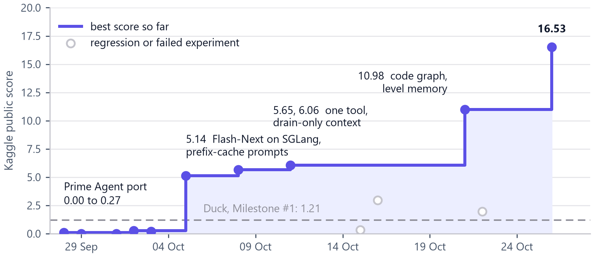
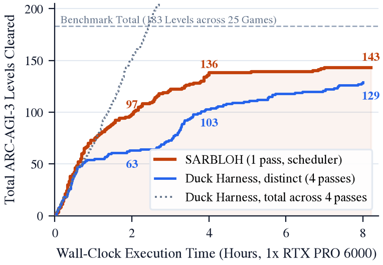
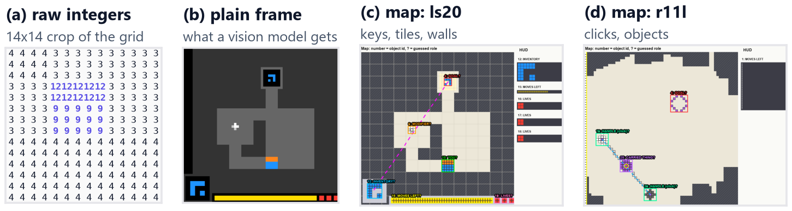

# SARBLOH

**An offline, open-weight agent for [ARC-AGI-3](https://arcprize.org/arc-agi/3/) (ARC Prize 2026), built around a
perception engine.**

ARC-AGI-3 drops an agent into a game it has never seen, with no instructions, and scores it by how few actions it
needs compared with a human. On Kaggle it also has to run offline, on one GPU, within nine hours. SARBLOH's starting
observation is that the first thing that breaks is not reasoning but *seeing*. So every frame passes through a
perception engine before the model sees it, and the model then acts by writing and running code.

The paper is in [`Writing/`](Writing/): *Seeing Before Acting: A Perception Engine for an Offline, Open-Weight
ARC-AGI-3 Agent* (arXiv preprint, AAAI-27 format). Build instructions are [below](#build-the-paper).

*Sarbloh* means "all-steel".

---

## Results at a glance

| | |
| --- | --- |
| **Kaggle hidden-set score** | **16.53** (26 Oct 2026), up from 0.27 on 2 Oct; Milestone #1 was won with 1.21 in June |
| Public games, one pass, 8.2 h | **143 / 183 levels** cleared (25 games) |
| Same server and model, Duck harness (4 passes per game) | 129 distinct levels in the same time |
| Median cleared level | 0.77x the human baseline's actions (earns the 1.15 RHAE cap) |
| Prompt tokens served from the prefix cache | **98.4%** over a 9-hour run (was ~10% before the append-only rewrite) |
| Model calls / server failures in 9 h | 21,224 / 0 |
| Hardware | one NVIDIA RTX PRO 6000 (96 GB), offline |
| Model | Qwen3.8-Flash-Next: 125B MoE, 6B active, W4A16, SGLang + EAGLE |

Public-game numbers are a development signal only: those games are partly memorised by now. The hidden Kaggle score
is the only uncontaminated number. The leaderboard leaders are far ahead (71.48 on 26 Oct); the paper says so plainly.





---

## How it works



```
            ┌──────────────────────── Perception engine (host side, pure code, ~35 ms/frame) ────────────────────────┐
 ArcHost ──►│ 1 segment + track ─► 2 layout ─► 3 measure facts ─► 4 guess roles + tests ─► 5 render map + letters │
 (game)     └──────────────────────────────────────────────────────────────────────────────────────┬────────────────┘
    ▲                                                                                               │ views
    │ moves, one at a time                                                                          ▼
 IPython kernel (the only tool) ◄── code ── Qwen3.8-Flash-Next (SGLang) ◄── prompt ── Context builder (append-only)
 observe() · play(path, predict) · recall() · graph() · GOAL/PLAN/HYPOTHESES/FINDINGS

 25 sessions ──► priority scheduler (10 GPU slots) ──► one model server with a watchdog; curator at every level-up
```

### 1. Perception engine: [`Sarbloh/harness/agent/perception.py`](Sarbloh/harness/agent/perception.py)
Every frame becomes three views that share one set of object ids:
- **Objects, letters, change lines.** 4-connected one-colour objects, tracked across steps in five passes
  (unchanged, moved, recoloured, reshaped, new), so `obj 10` means the same thing for a whole level. The board is drawn
  as one letter per colour, and each move adds one change line: `#12 A4(right): 6 cells changed at r10-12 c20-25`.
- **The briefing.** `MEASURED` facts are computed and true by construction: reach (BFS on the tile lattice), enclosure,
  tethers and midpoints, alignment, look-alikes under the 8 square symmetries times scale, copies, and lopsided colours.
  `GUESSES` are roles (YOU, GOAL, MOVES LEFT, LIVES, INVENTORY, MODIFIER, HANDLE, CARRIED), each printed with a
  confidence and **the one action that would confirm it**.
- **The picture.** A map of the layout rather than raw pixels: floor, walls, panels, tile lattice, role-tagged
  boxes, look-alike threads, midpoint rings, and an enlarged HUD panel.

The design was chosen in a perception lab ([`experiments/E115_perception_lab`](experiments/E115_perception_lab)):
eight competing arms were graded on a 28-point rubric. The winner scored 25/28 against 3/28 for the old encoder, at a
tenth of the tokens. A held-out check on 23 games showed single-frame role guesses are right only about half the
time, which is why they are labelled as guesses and come with a test.

### 2. Acting in code: [`runtime/skills/acting.py`](Sarbloh/harness/runtime/skills/acting.py)
One tool, a persistent IPython kernel (ported from [Prime Agent](https://github.com/PrimeIntellect-ai/prime-agent)).
The agent models the game in Python, searches its model, and sends the whole path with `await play(path, predict)`.
`play()` reports the first move its model got wrong and stops early on a level-up, a game over, a revisited board, or
a wall hit twice. The host owns the game ([`game/arc_host.py`](Sarbloh/harness/game/arc_host.py)): it checks and logs
every move, restarts lost levels, and the kernel cannot read the game files
([`runtime/skills/fileguard.py`](Sarbloh/harness/runtime/skills/fileguard.py)).

### 3. Memory and context: [`agent/context.py`](Sarbloh/harness/agent/context.py), [`memory/`](Sarbloh/harness/memory)
- **Append-only prompt.** The model is a Gated DeltaNet hybrid, so any edit to an old message forces a full prefill.
  Nothing already sent is changed: each picture is stored once, and memory goes in as diffs. Result: 98.4% prefix reuse.
- **Drain, not summarise.** Past 118k tokens the oldest whole turns are dropped, down to 55k, with no model call.
- **Memory as variables.** `GOAL`, `PLAN`, `HYPOTHESES` and `FINDINGS` are kernel dicts keyed by level. A hidden
  **curator** runs at every level-up, updates a cross-game lessons graph (with a store of refuted rules) and picks skill
  notes that `recall()` loads.
- **Code graph** ([`runtime/skills/codegraph.py`](Sarbloh/harness/runtime/skills/codegraph.py)): after every cell, one
  line says what the agent's code defined, changed, or now calls that is missing.

### 4. Serving and scheduling: [`llm/`](Sarbloh/harness/llm), [`scheduler.py`](Sarbloh/harness/scheduler.py)
- SGLang with a profile chain, a tool-call smoke test, and a watchdog. A frozen server counts as failed even when its
  process is alive. Restarts are budgeted by remaining wall clock.
- A priority scheduler: 25 games alive, 10 GPU slots. A free slot goes to the waiting game with the best
  (RHAE weight of its next level) x (hope), where hope decays with tokens and actions spent without progress.
- Everything model-specific lives in one spec file per model (`qwen_flash_next.py`, `qwen.py`, `gemma.py`,
  `nemotron.py`).

### 5. Alignment pipelines: [`Alignment/`](Alignment)
LoRA SFT and LoRA GRPO on the agent's own cleared-level traces (torch + transformers + peft, no TRL), with a
Kaggle notebook and TPU/Colab variants. They are built and tested. No gain on the hidden set has been shown yet, and
the policy is that RL is adopted only if it beats SFT within the same GPU budget.

---

## Repository map

```
SARBLOH/
  Sarbloh/                  THE agent (current SOTA build)
    harness/                ours: run.py, config.py (every knob), scheduler.py, trace.py, speed.py
      agent/                agent.py (turn loop), perception.py, context.py, guardrails.py, curator.py, prompts.py
      runtime/              kernel host + skills the model can call (acting, observation, codegraph, recalling)
      memory/               working memory, timeline, lessons graph, skill book
      game/                 arc_host.py (the only game access), games.py (Arcade wrapper)
      llm/                  client, server + watchdog, SGLang launcher, one spec per model
    rlm/                    Prime Agent's Python kernel runtime, vendored unchanged (MIT, see rlm/LICENSE)
  Sarbloh-Experimentation/  the copy where daily experiments run before promotion to Sarbloh/
  Alignment/                LoRA SFT + GRPO pipelines and notebooks
  Writing/                  the arXiv preprint: main.tex, sections/, figures/, data/, scripts/ (rebuild every figure)
  kaggle/                   submission and experiment notebooks (experimental/sarbloh_experimentation.ipynb is the
                            current submission), offline wheel builders
  experiments/              one folder per experiment: hypothesis.md (before code), config, results, verdict.md
  eval/                     official scorer, bench driver, the 25 public games for offline play, frozen splits
  _archive/                 pre-reorganisation code, read-only
```

---

## Quickstart

Requires Python 3.12 and [uv](https://docs.astral.sh/uv/).

```bash
uv sync                                   # base environment: arc-agi, notebook, LLM client, dev tools
uv sync --group train                     # + torch, transformers, peft for the alignment pipelines
```

**Play locally** against any OpenAI-compatible server (llama.cpp, vLLM, SGLang). Local runs test the plumbing; a small
local model's score says nothing about the 6B-active model on Kaggle. Set `local_SFT_RUN = False` in
`Sarbloh/harness/config.py` first, because when it is True the local entry point collects traces through the DeepSeek
API instead.

```bash
cd Sarbloh
uv run python -m harness.run --games ls20 --minutes 10 --max-actions 60 \
    --base-url http://127.0.0.1:8080/v1 --ctx 16384 --vision
```

**See the perception engine on a real frame** (writes the map, the plain frame, the briefing and the object list):

```bash
uv run python Writing/scripts/make_perception_figure.py ls20 r11l
cat Writing/figures/perception/ls20/briefing.txt
```

**Run on Kaggle.** The agent code reaches Kaggle as a dataset mirrored from this repository, so push to GitHub and
update the dataset first. Then:

```bash
uv run python scripts/kaggle_push.py experimentation          # push + run the submission notebook
uv run python scripts/kaggle_push.py experimentation-status   # poll
uv run python scripts/kaggle_push.py experimentation-output   # download outputs into runs/
```

Kaggle credentials go in a git-ignored `.env` (`KAGGLE_USERNAME` + `KAGGLE_KEY`) or in `~/.kaggle/kaggle.json`. The
notebook prints its environment, the merged config and its hash, and writes a summary plus per-game transcripts,
pictures and SFT rows.

### Build the paper

```bash
uv run python Writing/scripts/collect_data.py           # numbers, each with its source
uv run python Writing/scripts/extract_curves.py         # levels over time from the run logs
uv run python Writing/scripts/make_perception_figure.py ls20 r11l
uv run python Writing/scripts/plot_results.py           # PDFs for the paper, PNGs for this README
cd Writing && latexmk -pdf main.tex                     # -> Writing/output/main.pdf (needs TeX Live)
```

`extract_curves.py` and `collect_data.py` read run folders under `runs/`, which are not in git because they are large.
The derived JSON is committed in `Writing/data/`.

---

## How we work

- **Iteration beats theory.** Push to Kaggle, read the trace, refine, repeat. A run that scores 0 but leaves a trace is
  worth more than a design document.
- **Every change is an experiment.** `experiments/E###_*/hypothesis.md` states the mechanism, the prediction and the
  kill criterion *before* any code. `verdict.md` records kept, killed or inconclusive, and negative results stay.
- **Everything is wrong until a run proves it**, including our own explanations of the model's behaviour.
- **Method follows hardware.** RL is a hypothesis like any other: it has to beat LoRA SFT inside Kaggle's budget.

---

## Licence

Apache-2.0: see [`LICENSE`](LICENSE) and [`NOTICE`](NOTICE). `Sarbloh/rlm/` is vendored from Prime Agent and keeps its
MIT licence. The 25 public games in `eval/real_games/` belong to the ARC Prize Foundation. Model weights and
third-party repositories are not redistributed.

## Citation

```bibtex
@misc{banwait2026sarbloh,
  title  = {Seeing Before Acting: A Perception Engine for an Offline, Open-Weight {ARC-AGI-3} Agent},
  author = {Banwait, Harsidak Singh},
  year   = {2026},
  note   = {arXiv preprint},
  url    = {https://github.com/Harsidak/SARBLOH}
}
```

## Acknowledgements

The ARC Prize Foundation for ARC-AGI-3. Prime Intellect for Prime Agent, whose kernel and host loop this harness
started from. Tufa Labs for the Duck harness, the Milestone #1 winner and our baseline throughout.
